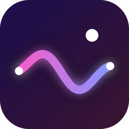

<p align="center">
  
</p>

<h1 align="center">Animated Lyrics for Windows</h1>

<p align="center">
  Lyrics of whatever you're playing, animated word by word, in album colours, with light flowing around the edges of your screen.
</p>

<p align="center">
  <a href="https://github.com/Adarsh-Aravind/animated-lyrics-windows/releases/latest"><b>⬇ Download for Windows</b></a>
</p>

> **Inspired by [Verci](https://www.verci.xyz) and [Lumn](https://trylumn.xyz).** Those are Mac apps for animated lock-screen lyrics and screen-edge lighting. They don't exist for Windows, so this is a Windows remake of the same idea, built from scratch. It's an independent fan project, not affiliated with or endorsed by Verci or Lumn, and it doesn't use any of their code or artwork. If you're on a Mac, use the real apps.

---

## What it does

- **Follows any player.** Spotify, Apple Music, YouTube / YouTube Music in a browser, SoundCloud, Tidal, Deezer… anything that shows up in the Windows media controls. No login, no API keys.
- **Synced lyrics.** Time-synced lyrics come from [LRCLIB](https://lrclib.net), and the timing follows the player exactly, including pauses and seeks.
- **17 animation styles.** Glide · Chat · Pop · Stack · Spotlight · Bounce · Love · Wave · Scatter · Depth · Focus · Neon · Collage · Board · Glitch · Type · Cinema
- **Chat style.** The song plays out as two people texting: typing dots, bubbles from both sides, read ticks and the odd reaction.
- **Landing screen.** Every style plays its own live preview in a gallery, with a large preview of the one you pick. Star your favourites so ← / → only cycle through those.
- **Glass menus.** Text, Background, Light and Screens settings in frosted-glass panels.
- **Player status.** Spotify and Apple Music icons with live status lights. The status panel shows every open player, which one the lyrics are following, whether lyrics were found and how they're timed, *Too early / Too late* sync buttons, and *Search lyrics again*.
- **Album colours.** Text, background and lights use only colours taken from the song's cover.
- **Backgrounds.** Animated gradient, blurred cover, album cover, or black.
- **Edge lighting.** *Flow* (light racing around the screen edges), *Glow*, or *Side lights*. They pulse with every word.
- **Every screen.** One switch puts full-screen lyrics on all your monitors, all in sync.
- **Easy.** *Surprise me* button, *New style every song*, and *Too early / Too late* buttons that remember the fix for each song.
- **Handles odd versions.** Music-video titles, remasters, and *slowed / sped-up* edits (the timing is stretched to fit).

## Install

1. Download **`Animated-Lyrics-Windows.zip`** from the [latest release](https://github.com/Adarsh-Aravind/animated-lyrics-windows/releases/latest).
2. Unzip it anywhere, for example in Documents.
3. Open **`Animated Lyrics.exe`**. The first time, it adds a Desktop and Start-menu shortcut.
4. Play a song.

> Windows may say *"Windows protected your PC"* because the app isn't code-signed. Click **More info → Run anyway**.

**Needs:** Windows 10 or 11, Microsoft Edge (built into Windows) and an internet connection to fetch lyrics.

## Using it

The app opens on the landing screen. Pick a style from the gallery and press **Start**. While the lyrics are playing, move the mouse to bring up the dock (style switcher, surprise, play/pause, full screen). Press **Esc** to return to the landing screen. Double-click anywhere for full screen.

| Key | Action |
|---|---|
| Esc | Landing screen ↔ lyrics |
| Enter | Start (from the landing screen) |
| ← / → | Previous / next style (only favourites, if you starred two or more) |
| S | Surprise me (random style, background and light) |
| B | Background: Gradient → Blurred cover → Album cover → Black |
| L | Edge light: Flow → Glow → Side lights → Off |
| C | Album colours / white text |
| I | Show / hide the song name |
| F | Full screen |
| [ / ] | Lyrics too early / too late (saved per song) |
| Space | Play / pause |

When nothing is playing, a short preview runs so you can try the styles.

## How it works

```
Windows media controls ──► Python backend ──► WebSocket ──► animated page in an Edge app window
 (what's playing, position)   (aiohttp, LRCLIB lookup,         (styles, album palette,
                               cover art, settings)             edge lighting)
```

- `app/media.py` reads the current song, position and cover through the Windows `GlobalSystemMediaTransportControls` API.
- `app/lyrics.py` cleans up titles and finds synced lyrics on LRCLIB. Results are cached locally.
- `app/server.py` streams the track, lyrics and playback state to every open window, and keeps settings shared between screens.
- `app/screens.py` opens one full-screen window per extra monitor.
- `web/` is the front end: `engine.js` handles word timing, `styles.js` the 17 styles, `visuals.js` the palette, backgrounds and edge lights, and `home.js` the landing screen, glass menus and dock. Gallery previews are the same page loaded with `?preview=<style>`.

Most songs only have line-by-line timing, so the timing of words within a line is estimated. It's exact when LRCLIB has word-level lyrics.

## Run from source

```bat
setup.bat                 :: creates .venv and installs requirements
"Animated Lyrics.bat"     :: starts the app
```

Or run `python main.py`. Options: `--fullscreen`, `--browser` (use your normal browser), `--port 5757`.
Preview the styles without music at `http://127.0.0.1:5757/?demo`.

### Build the .exe

```bat
build.bat
```

This produces `dist\Animated Lyrics\Animated Lyrics.exe` and a zip ready to share. It uses PyInstaller.

Settings, the lyrics cache and the log live in `%LOCALAPPDATA%\AnimatedLyrics` for the .exe, or in `cache\` when running from source.

## Credits

- **Idea:** [Verci](https://www.verci.xyz) (animated lyrics) and [Lumn](https://trylumn.xyz) (screen-edge lighting) for macOS. This project is an unofficial Windows take on what they do. It isn't affiliated with or endorsed by either app, and it shares no code or assets with them.
- **Lyrics:** [LRCLIB](https://lrclib.net), a free, community-run library of synced lyrics.
- **Cover art fallback:** the iTunes Search API, used when a player doesn't provide a cover.
- **Trademarks:** Spotify, Apple Music, WhatsApp and Windows are trademarks of their owners. Their names and logos appear only to show which player is connected or what a style looks like. This project isn't affiliated with any of them.
